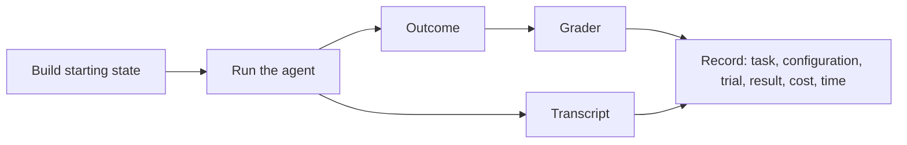

# Agent evaluation

An eval (evaluation) runs an agent on tasks and scores the results, using evidence the agent can't influence. Teams use evals to make decisions they'd otherwise make on gut feel: whether a prompt change helps, whether to switch models, whether a release broke something.

## The short version

A small agent eval that holds up in discussion:

1. Starts from a failure you actually saw.
2. Builds each task's starting state the same way every time, with a script.
3. Grades the final state with code the agent can't touch, not what the agent says.
4. Runs each task several times per version, because agents vary.
5. Compares the new version against the current one on the same tasks, with one difference only.
6. Writes down, before running, what result means keep, revert or unsure.
7. Records each run's result, cost and time, and keeps its transcript.

The rest of this guide explains each idea.

## The vocabulary

| Term | Meaning | Example |
| --- | --- | --- |
| Task | One problem: a starting state, an instruction and a success criterion. Also called a test case. | "In this repo, make the failing test pass." |
| Trial | One attempt at a task. Also called a run or an attempt. | The third run of that task with the new prompt. |
| Configuration | Everything that defines the agent under test: model, instructions, tools, permissions, budgets. | The same model, the old prompt, shell access allowed. |
| Transcript | The full record of a trial: messages, tool calls and their results. Also called a trace or trajectory. | The agent read `app.py`, ran `pytest`, then edited line 40. |
| Outcome | The final state of the environment after the trial. | The repo's branches, commits and files. |
| Grader | What scores a trial: code, a model or a person. A task can have several. | A script that runs the tests. |
| Suite | A collection of tasks that measures one capability or behavior. | 30 bug-fix tasks. |
| Harness | The code that sets up each trial, runs the agent, then grades and records the result. | A Python script that loops over tasks and configurations. |

## Grade the outcome, not the claim

Agents often report success they didn't achieve. Grade the final state instead: run the tests, check the branch, query the database.

| Grader | Use it for | Watch out for |
| --- | --- | --- |
| Code | Anything a program can check: the tests pass, a file exists, the right branch has the commit | Brittle: it can fail a valid solution you didn't anticipate, and it only checks what you thought of |
| Model as judge | Quality code can't check, such as whether a review comment is correct or an explanation is clear | Noisy and biased: give it a specific rubric, and compare it with human grades before trusting it |
| Human | The ground truth, and checking the other two | Slow and expensive, and people disagree, so measure how often they agree |

The usual rule: code where you can, a model where you must, and people to check both.

Grade what the agent produced, not the exact steps it took: agents often find valid paths you didn't expect. Check the steps only where they matter in themselves, such as a forbidden command, a step the instructions require, or cost.

Keep the grader and its reference data outside the agent's reach. An agent that can edit the tests can make them pass. Look for loopholes too: a grader that only checks a file exists passes an empty file.

## Make every trial fair and repeatable

- **Rebuild the starting state identically.** A script or snapshot creates it, with versions pinned: commit IDs, package versions, the exact model ID. Then a difference between runs comes from the agent, not the setup.
- **Isolate trials.** Each trial starts fresh, with no files, caches, memory or conversation left over from another. Shared state makes failures look related, and scores better or worse than they are.
- **Write unambiguous tasks.** Two experts should agree on whether a result passes. Write a reference solution and check that it passes. If a task fails on every trial, suspect the task or the grader first.
- **Use real tasks.** Start from failures you've seen: bug reports, incidents, bad transcripts. 20 to 50 real tasks are a good start, and a handful is fine for a first pilot.
- **Balance the set.** Include cases where the agent should act and cases where it should hold back, such as stopping or asking. Otherwise you tune it in one direction only.

## Agents vary: run each task more than once

The same task and configuration can pass once and fail the next time. So run each task several times, and report counts with their totals: "7 of 10", not "70%". With 10 trials, one trial moves the rate by 10 points.

Two ways to summarize several trials:

- **pass@k:** the chance that at least one of k trials succeeds. It fits when a person picks the best of several tries, or a retry is cheap.
- **pass^k** ("pass hat k"): the chance that all k trials succeed. It fits a tool people expect to work every time. It drops fast: an agent that succeeds 75% of the time passes three in a row only 42% of the time (0.75³).

With small samples, a difference of one or two tasks can be chance. When a decision rides on it, use confidence intervals: [Anthropic: A statistical approach to model evaluations](https://www.anthropic.com/research/statistical-approach-to-model-evals) shows how.

## Compare two versions fairly

- **Run the baseline now.** Compare against the current version, run today on the same tasks, not against an old score: models and tools change.
- **Change one thing.** The two configurations should differ only in what you're testing. A second difference, called a confound, means you can't tell which one caused the result.
- **Compare task by task.** Totals hide what changed. "A passes 16 of 20 and B passes 14" could mean A passed everything B did plus two more, or that each passed several the other failed. The tasks where they disagree are your evidence: six disagreements split 4 to 2 is weak, and 6 to 0 is stronger.
- **Include a control:** a task where you expect no difference. If the versions differ there, something other than your change is at work.
- **Alternate the runs.** Interleave the two versions, so a change during the runs, such as API load, doesn't line up with one of them.

## Test the grader

A grader is code, so it can be wrong.

- **A known-wrong result it must reject.** Pick one a careless grader would accept: right on the obvious check and wrong on another, such as the correct change committed to the wrong branch.
- **A known-right result it must accept.** A grader that rejects everything looks strict until you try this.
- **Spot-check a model judge** against human grades on a sample.
- **Read failed trials.** If the grader failed good work, fix the grader, not the agent.

## Tell failures from errors

Every trial gets one of three results:

- **Pass:** the task was done.
- **Fail:** the agent ran, the grader ran, and the task wasn't done.
- **Error:** the trial couldn't run or couldn't be graded, such as a timeout, a rate limit, a broken starting state or a crashed grader.

Errors say nothing about the agent, so report them separately, and never count them as passes or failures. Record a measurement you don't have, such as tokens the tool doesn't show, as unknown, not 0.

## Read transcripts

Scores say whether the agent succeeded. Transcripts say why. Read some regularly, from failures and successes:

- Find the first step where the trial left the expected path.
- Name the cause: an agent mistake, an unclear task, a grader bug or a problem with the environment.
- Across many transcripts, count each kind of failure, so you fix the most common one first. This is called error analysis.
- Read some passes too: a pass can come from luck, or a shortcut such as editing the test instead of the code.

## Measure the cost

Record for each trial its tokens or price, its wall-clock time, and its number of turns or tool calls. Look at the slowest runs, not only the average, and count the human time spent checking the output. A change that adds one pass but doubles the cost may not be worth it.

## Capability evals and regression evals

- **A capability eval** holds tasks the agent can't do reliably yet. A low pass rate is expected, and it tracks progress.
- **A regression eval** holds tasks it already does. It should stay near 100%, and runs on every change, like CI, to catch breakage.

Once the agent reliably passes a capability task, move it to the regression suite. A suite where everything passes, called saturated, stops telling you anything: add harder tasks.

## Decide before you look

Write down, before running, what result means keep, revert or collect more data. Rough thresholds are fine. A rule written after seeing the results tends to fit whatever they happened to show. For example:

- **Keep** the new version if it wins more of the tasks where the versions disagree, and costs at most 1.5 times as much.
- **Revert** if it fails a task on the regression suite.
- **Unsure** if they tie, or the margin is a single task: run more trials.

## When the agent flags things

Some agents flag problems, such as a review agent commenting on defects. Two numbers matter:

- **Precision:** the share of flags that were real. 6 confirmed out of 10 flags is 60%.
- **Recall:** the share of real problems it found. If people find 3 more it missed, recall is 6 of 9.

Counting flags can't reveal what was missed. You need a set with known answers, or a human audit.

## From eval to production

An offline eval covers only the tasks you wrote. Roll an agent out in steps: advisory first, such as comments a person can ignore, then blocking, such as a check that stops a merge. Decide in advance what pauses the rollout, what lets it expand, and how to roll back. Once it's live, keep watching it with monitoring, user feedback and some transcript review, since each catches failures the others miss.

## Report what you found

Lead with the decision, then the evidence:

1. What you tested, and what you recommend.
2. Results by task and version, as counts with totals, with errors listed separately.
3. One concrete failure: what was expected, what happened, and the first step that went wrong.
4. Limits: how few runs it rests on, other explanations (chance, a setup change during the runs, an unintended difference between versions), and what you'd run next.

The final state shows what happened, and a transcript suggests why. Say which you have.

---

## ⚠️ SPOILERS: questions and answers

Prepare using only the text above this line. Everything below it asks the questions and then answers them.

### Questions

1. What are a task, a trial and a grader, and why does a task get several trials?
2. An agent's last message says "All tests pass, the feature is done." How do you grade the trial?
3. When would you grade with a model instead of code, and how would you know you can trust it?
4. Why grade the outcome rather than the exact steps? When do the steps matter?
5. Agent A passes 16 of 20 tasks and agent B passes 14. Is A better?
6. An agent succeeds on 90% of trials. What are its pass@3 and pass^3, and which matters for a check that runs on every pull request?
7. Of 10 trials, 6 pass, 2 fail and 2 time out. What do you report?
8. How do you test a grader?
9. What's the difference between a capability eval and a regression eval?
10. A prompt change raises the eval score. What do you check before shipping it?
11. After a model upgrade, the eval score drops. What do you look at first?

**Stop here.** Answer every question aloud before you read on.

### Answers

1. A task is one problem, with a starting state and a success criterion. A trial is one attempt at it. A grader scores the trial. Agents vary between runs, so one trial can't tell a reliable agent from a lucky one.
2. Ignore the claim and inspect the outcome: the grader runs the tests itself and checks the files and commits. Agents report success they didn't achieve.
3. When a program can't check the quality, such as whether a review comment is correct or an explanation is clear. Give the judge a specific rubric, grade a sample by hand as well, and trust it only if it agrees with people about as often as people agree with each other.
4. Agents find valid paths you didn't expect, and grading the steps fails them. Steps matter when they matter in themselves: a forbidden command, a required step, or cost.
5. Not shown yet. Ask which tasks each passed: if A passed every task B did plus two more, A has a small lead; if they disagree on many tasks, the picture is mixed. Two tasks out of 20 can also be chance, so repeat the runs, and check how the grader defines success.
6. pass@3 is 1 − 0.1³ = 99.9%, the chance that at least one of three succeeds. pass^3 is 0.9³ ≈ 73%, the chance that all three do. A check on every pull request has to work every time, so pass^3 is the one that matters. Both assume the trials are independent.
7. 6 passes and 2 failures out of 8 graded trials, and 2 errors reported separately. The errors say nothing about the agent: find out why they timed out, and rerun them.
8. Give it a known-wrong result it must reject, chosen to fool a careless grader, and a known-right result it must accept. For a model judge, compare its grades with people's on a sample.
9. A capability eval holds tasks the agent can't do reliably yet, and a low score is expected. A regression eval holds tasks it already does, should stay near 100%, and runs on every change. A task moves from the first to the second once the agent passes it reliably.
10. That the gain is bigger than run-to-run variation, task by task; that the regression suite and controls didn't get worse; the cost and time; a few transcripts, to see the passes aren't shortcuts; and the rule you wrote before running.
11. Separate errors from failures first, since a new model can break the harness, such as with a new output format. Then compare task by task, read the failing transcripts, and check the grader isn't failing valid answers the new model gives in a different form.
