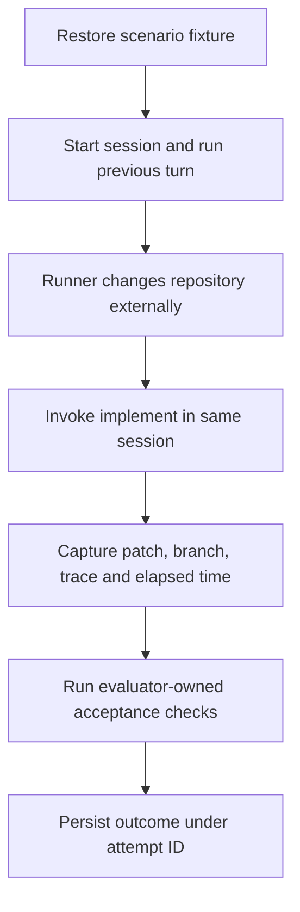

# Run real trials

Use 10–20 minutes to study the material below. Questions and answers are at the end, behind a spoiler warning.

## Follow one trial end to end

A runner coordinates the experiment. The agent harness executes the agent. The grader inspects the resulting repository. Keeping these jobs distinct lets you tell whether a bad outcome came from the task, its execution, or its measurement.

For S1, the previous turn confirms old-task is done. Switch the fixture to new-task outside the session. Invoke the skill without a path. A convincing "already complete" message is perfectly compatible with an unchanged, incorrect fixture. Capture the actual state before resetting anything.

## Build the smallest runnable path

1. Assign scenario, configuration and attempt IDs. Record fixture revision, exact instructions, model and harness versions where available, tools, permissions and budgets.
2. Use the existing invocation method. If integration consumes the timebox, invoke manually and let Python validate saved artifacts. Record which steps were manual.
3. Capture failures as well as successes. A timeout needs a duration and diagnostic. An unavailable token count should stay unknown; zero would imply a measurement.
4. Replace the external invocation with a fake in one test. Have it return a known failure and verify the runner persists the right diagnostic and identifiers. A fake supplies predetermined behavior, so its result belongs to runner testing.
5. Execute real trials and keep actual grader output attached to each record.

Save one complete record plus its artifacts, then check the same fields for the remaining scenarios.

---

## ⚠️ SPOILERS: questions and answers

Prepare using only the text above this line. Everything below it asks the questions and then answers them.

### Questions

1. Why keep the runner, the agent harness and the grader as separate jobs?
2. In S1 the agent replies that new-task is already complete. What do you check, and why isn't the message enough?
3. A trial's token count isn't exposed. What do you record, and why not 0?
4. What does a test with a fake invocation show, and what can't it show?
5. Could another person identify the precise starting state and reproduce your sequence? What must each record hold for that?
6. How would someone tell a second attempt from a duplicate record of the first?

**Stop here.** Answer every question aloud before you read on.

### Answers

1. So that a bad outcome can be traced to the task, to its execution, or to its measurement.
2. The final repository state: its branch, commits and files, captured before anything is reset. A convincing message is compatible with an unchanged, incorrect fixture.
3. Record it as unknown, such as `null`. Zero claims you measured zero tokens.
4. That the runner records outcomes, diagnostics and identifiers correctly for a known result, offline and at no cost. Nothing about how the real agent behaves, since the fake's behavior was chosen in advance.
5. Only if each record holds the fixture revision, the exact instructions, model and harness versions, tools, permissions and budgets, and the runner's steps, manual ones included.
6. Each attempt has its own unique trial ID and its attempt number. A duplicate repeats a trial ID that's already recorded.
