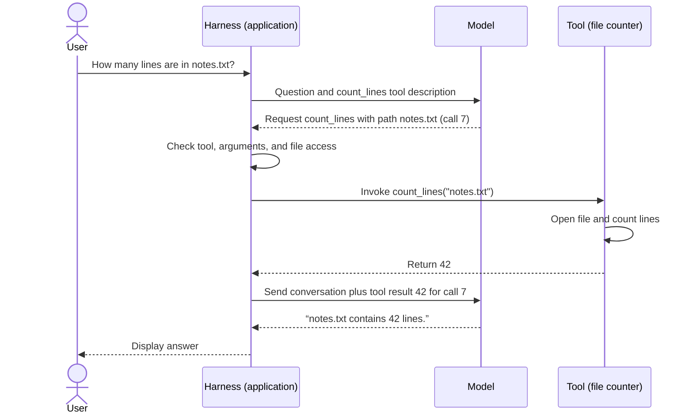

# P1A2 — AI agent basics

Allow 20 minutes. Spend 6 minutes on tokens and prediction, 5 on context and training, 5 tracing the tool call, and 4 on the questions at the end, which sit behind a spoiler warning.

## Trace one prediction

Imagine typing `Please open the file`. You see letters arranged into words. The language model needs a sequence of numbers to work with. A **token** is one unit in that sequence. For ordinary text, each unit stands for a piece of the original text. The **vocabulary** is the model's inventory of possible units. Each entry has a number called its **token ID**.

A **tokenizer** is the software that translates between text and those IDs. It uses a vocabulary and splitting rules chosen for the model. Here is one *invented* encoding so you can follow it by eye.

| Text pieces, in order | Token IDs, in order |
| --- | --- |
| `Please` · ` open` · ` the` · ` file` | 81 · 205 · 17 · 93 |

In this example the leading space is part of each of the last three tokens. The prompt has 20 characters including spaces, four tokens, and four IDs. The ID 205 identifies one vocabulary entry. Its numerical size tells you nothing about the length or meaning of that entry.

**How big is a token?** There is no fixed character count. A frequent word might occupy one token. A longer or less familiar word might split into several. Punctuation, spaces, and parts of words can each form tokens. Some tokenizers operate on bytes, the units computers use to store text. A single visible symbol such as an emoji can span several bytes and several tokens. Some vocabularies also reserve special tokens for boundaries such as the end of a response.

**Would another model count the same four tokens?** Models that share a tokenizer can encode the same plain text identically. A different tokenizer might split `Please` into smaller pieces or encode the space before `file` separately. Even identical pieces can have different IDs in different vocabularies. To count a passage exactly, encode it with the tokenizer that matches the model and count the resulting IDs. Counting a whole chat request may also require accounting for how the service packages messages and tool descriptions.

**Where does the tokenizer live?** In a typical hosted chat, your app sends text and the model service runs the matching tokenizer before passing IDs to the model. A local model runner can load the tokenizer files alongside the model on your computer. In either setup, the model uses each input ID to look up a learned list of numbers called an **embedding**, then processes those numbers in context. On the way out, tokenizer software decodes the generated IDs back into text.

### How the next token is chosen

A language model takes the tokens so far and assigns **next-token probabilities** across its vocabulary. Imagine this simplified distribution for the next position. The numbers are illustrative.

| Possible next token | Probability |
| --- | ---: |
| ` door` | 50% |
| ` file` | 30% |
| ` window` | 20% |

**Greedy decoding** picks the token with the highest probability, so it selects ` door`. **Sampling** draws a token at random using the probabilities as weights. Across many draws from this same distribution, you would expect roughly three in ten to select ` file`. Either method appends the selected token and runs another prediction. After `Please open the file`, the next distribution can differ from the one after `Please open the door`.

Greedy makes a fresh decision at every position. Picking the most probable first token does not guarantee the most probable complete sentence, because later choices depend on the prefix. With sampling, even an identical prefix and identical probabilities can yield different continuations across runs. In the table, 50% for the first token describes just one decision, before the next token has been chosen.

A probability here measures how likely a continuation is under the model. Factual accuracy requires a separate check.

## What fits in context?

The **context** is the information available to the model for its current prediction. For example, the same question, “How long is it?”, calls for different answers after a discussion of a file and after a discussion of a walking route. The preceding messages supply the reference for “it.”

The **context window** is the maximum number of tokens a model can process together. Instructions, conversation history, tool descriptions, and tool results can all take up space. In a model with a shared input and output budget, generation also needs room. For example, if the window is 8,000 tokens and the input uses 6,500, at most 1,500 remain for the response. A separate output cap can reduce that further.

Imagine a long chat where you gave a filename in the first message. If the application drops that message to fit newer material, the next model call can use the filename only if it appears elsewhere in the supplied context or is recovered, for example by a lookup.

## Training and inference

**Training** is the process of learning from examples. A model has many adjustable numbers that shape how its input becomes a prediction. During training, a learning algorithm called an **optimizer** updates the model's numerical parameters, called weights. In next-token pretraining, a passage supplies practice examples. Given the prefix `Please open the`, the model predicts a distribution. If the actual next token in that passage is ` file`, a score called the **training loss** measures how poorly the prediction fits that observed token. Assigning the observed token a lower probability gives a larger loss. Across many examples, the optimizer adjusts the weights to reduce that loss.

**Inference** means running an already trained model on an input to obtain a prediction or output. When you send a chat message, generating the reply is inference. A single response usually involves many next-token predictions with the same weights. Suppose you tell it, “In this project, ‘the file’ means notes.txt.” It can use that definition on the next turn because the application includes it in context. This is an example of changing the input while keeping the weights fixed.

## Follow a tool call

A user asks, “How many lines are in notes.txt?” The file contents are outside the conversation. Three components take part.

| Component | Job in this example |
| --- | --- |
| **Model** | Selects a suitable tool from the supplied descriptions, generates a request with arguments, and later uses the result to answer. |
| **Harness** | The application code running the interaction. It supplies the tool descriptions, checks the requested name, arguments, and permissions, invokes the tool, and sends the result back into model context. |
| **Tool** | A callable function or service. Here, a local function opens the file, counts its lines, and returns a number or an error. |

A **tool-call request** is a structured model output that names a tool and supplies its arguments, the input values it needs. Here the name is `count_lines` and the path argument is `notes.txt`. The harness has already registered that name with a function it can run. Follow the arrows in time order.

**Why are there two calls to the model?** In the first, the model has a question and a description of a capability. Its output asks the application to use that capability. The harness runs the function and attaches its result to the conversation. The call ID connects the result to the request that produced it. In the second inference call, the model has new evidence in its context and can turn the number into an answer. Its weights stay the same throughout.

**Trace a failure.** Suppose the tool opens the path and gets a “file missing” error. The harness returns that error to the model in place of 42. The model can now ask the user for the correct path. Compare that with a successful result of zero, which would mean the tool read an empty file. The difference comes from what the tool actually observed.

---

## ⚠️ SPOILERS: questions and answers

Prepare using only the text above this line. Everything below it asks the questions and then answers them.

### Questions

1. Explain how a prompt becomes tokens and how the model generates two more tokens. Where does the choice between greedy decoding and sampling enter?
2. If the next-token weights changed to 40% ` door`, 45% ` file` and 15% ` window`, what could each decoding method produce?
3. Explain why adding a definition to a chat can change the next reply, and why a later model call might lose access to that definition.
4. Draw the file-count exchange from memory. Mark the first point where the harness has evidence for the number 42.

**Stop here.** Answer every question aloud before you read on.

### Answers

1. The tokenizer encodes the prompt as token IDs. The model scores possible next tokens, the decoder chooses one, and the process repeats with the chosen token appended. The choice between greedy and sampling is made by the decoder, at each of those steps.
2. Greedy picks ` file` at 45%. Sampling can pick any of the three, including ` window` at 15%.
3. Inference conditions on the supplied context. The new definition changes that context. If the application later omits it, the model loses that cue. Training changes the weights; a chat message doesn't.
4. Model request → harness checks and invocation → tool reads and counts → harness receives 42 → harness supplies result to model → model answers. The harness first has evidence for the count when the tool returns successfully.
