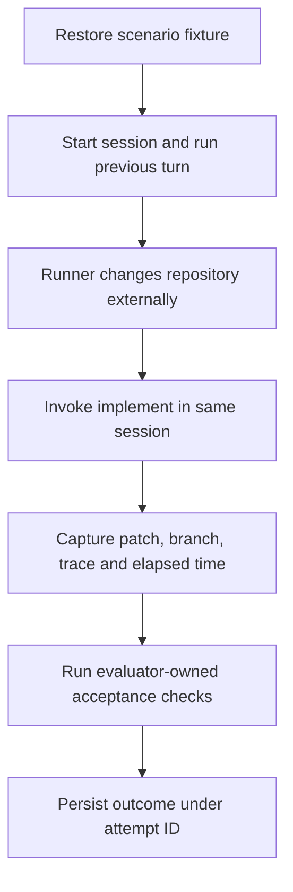

# P2A2 — Run real trials

Use 10–20 minutes to study the example and answer the recall questions. The full activity has a 90-minute timebox, including study.

## Follow one trial end to end

A runner coordinates the experiment. The agent harness executes the agent. The grader inspects the resulting repository. Keeping these jobs distinct lets you tell whether a bad outcome came from the task, its execution, or its measurement.

For S1, the previous turn confirms old-task is done. Switch the fixture to new-task outside the session. Invoke the skill without a path. A convincing “already complete” message is perfectly compatible with an unchanged, incorrect fixture. Capture the actual state before resetting anything.

## Build the smallest runnable path

1. Assign scenario, configuration and attempt IDs. Record fixture revision, exact instructions, model and harness versions where available, tools, permissions and budgets.
2. Use the existing invocation method. If integration consumes the timebox, invoke manually and let Python validate saved artifacts. Record which steps were manual.
3. Capture failures as well as successes. A timeout needs a duration and diagnostic. An unavailable token count should stay unknown; zero would imply a measurement.
4. Replace the external invocation with a fake in one test. Have it return a known failure and verify the runner persists the right diagnostic and identifiers. A fake supplies predetermined behavior, so its result belongs to runner testing.
5. Execute real trials and keep actual grader output attached to each record.

## Check your evidence

Could another person identify the precise starting state and reproduce your sequence? Could they distinguish a second attempt from a duplicate record of the first? Save one complete record plus its artifacts, then check the same fields for the remaining scenarios.
