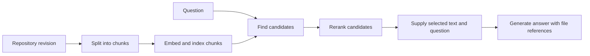

# P2A4 — Retrieval and training

Use 10–20 minutes to study the example and answer the recall questions. The full activity has a 45-minute timebox, including study.

## Answer a question about yesterday’s code change

Suppose a developer asks, “Which setting limits parallel branch checks?” The answer lives in a private repository whose contents change daily. Retrieval-augmented generation (RAG) finds relevant material at request time and supplies it as context for a generated answer.

A **chunk** is a retrievable portion of a document, perhaps a function plus its docstring. Small chunks can omit the definition needed to interpret a line. Very large chunks can crowd out other evidence. Attach file path, revision and permissions to each chunk.

An **embedding** is a learned list of numbers representing features of an input. A retrieval system compares the question’s vector with indexed vectors to find candidates. Similarity can bring back related concepts even when words differ. Exact text search can also help with identifiers. A **reranker** looks more closely at the question and candidate passages together to reorder a short list. Generation then uses the selected text as part of its input.

## Decide what to change

Fine-tuning continues training on examples and updates learned parameters, which can include a small set of adapter weights. It can teach a recurring response format or behavior. Daily source changes can instead be reflected by refreshing affected index entries. Check read permissions at retrieval time and carry the revision into the answer.

## Diagnose before tuning

If yesterday’s identifier appears in the answer, inspect the index revision, candidate list, final context and generated text in order. A missing new file suggests an indexing issue. A correct passage retrieved but dropped suggests a ranking or context issue. An accurate passage included but contradicted points to generation. Draw the pipeline from memory and identify which change would require retraining weights.
