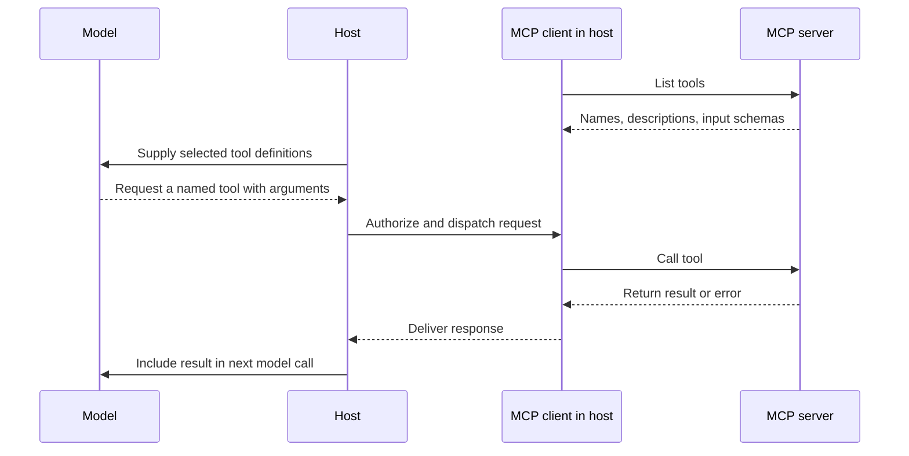

# P3A3 — Context, tool schemas, and MCP

Use 10–20 minutes to study the material below. The full activity has a 45-minute timebox, including study. Questions and answers are at the end, behind a spoiler warning.

## Reconstruct what the model could know

Context is the information supplied to a model call. Scoped loading means selecting information relevant to the current task, such as the requirement for the current branch. Compaction replaces older conversation material with a shorter representation. A summary can preserve yesterday’s branch name perfectly and still be wrong about the current checkout.

Durable working state survives a model call or process restart. Examples include a saved task record, a committed requirement and the actual Git checkout. For a property that can change between turns, identify the authoritative source and when it must be read. A saved observation needs a timestamp or revision to interpret it.

## Trace a tool call across MCP

Model Context Protocol (MCP) gives applications a common way to communicate with servers exposing capabilities such as tools. The host is the application coordinating the interaction. Its client handles protocol communication with a server. A server advertises tools and implements or delegates their execution.

A description tells the model when a tool is useful. An argument schema specifies fields, types and required values. For a branch lookup, a required string called repository can reject a missing argument. A correctly typed path can still point to the wrong checkout. The application and server must check access and meaning where appropriate.

## Rehearse a real failure

Sketch the stale-branch incident or another incident you experienced. Write four lines: what the model saw, what changed outside its view, which observation could resolve the mismatch, and where its result enters context.

---

## ⚠️ SPOILERS: questions and answers

Prepare using only the text above this line. Everything below it asks the questions and then answers them.

### Questions

1. What does compaction do, and how can a perfect summary still be wrong?
2. Give two examples of durable working state. What does a saved observation need before you can interpret it later?
3. In MCP, what do the host, the client and the server each do?
4. What does a tool's description do, and what does its argument schema do?
5. A branch-lookup tool receives a correctly typed path that points to the wrong checkout. What catches that?
6. Why could adding more old conversation leave the stale-branch error intact?

**Stop here.** Answer every question aloud before you read on.

### Answers

1. It replaces older conversation with a shorter representation. A summary can preserve yesterday's branch name perfectly and still be wrong about the current checkout: it records the past faithfully, and the repository has moved on.
2. Any two of a saved task record, a committed requirement and the actual Git checkout. A saved observation needs a timestamp or revision.
3. The host is the application coordinating the interaction: it decides which tool definitions reach the model, and authorizes and dispatches calls. The client, inside the host, handles protocol communication with one server. The server advertises tools, with names, descriptions and input schemas, and implements or delegates their execution.
4. The description tells the model when the tool is useful. The schema specifies fields, types and required values, so a malformed call, such as one missing a required argument, can be rejected.
5. Not the schema, since the type is right. The application and server must check access and meaning, such as whether the path is the repository the task concerns.
6. The error comes from stale information, and more old conversation adds more of the same stale branch. What resolves it is a fresh observation from the authoritative source, such as `git status`, entering context as a tool result before the agent decides.
