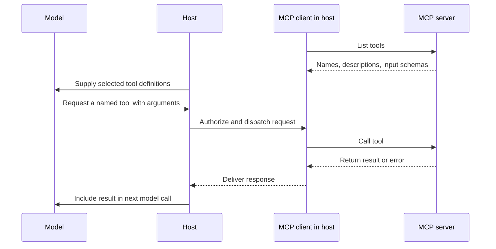

# P3A3 — Context, tool schemas, and MCP

Use 10–20 minutes to study the example and answer the recall questions. The full activity has a 45-minute timebox, including study.

## Reconstruct what the model could know

Context is the information supplied to a model call. Scoped loading means selecting information relevant to the current task, such as the requirement for the current branch. Compaction replaces older conversation material with a shorter representation. A summary can preserve yesterday’s branch name perfectly and still be wrong about the current checkout.

Durable working state survives a model call or process restart. Examples include a saved task record, a committed requirement and the actual Git checkout. For a property that can change between turns, identify the authoritative source and when it must be read. A saved observation needs a timestamp or revision to interpret it.

## Trace a tool call across MCP

Model Context Protocol (MCP) gives applications a common way to communicate with servers exposing capabilities such as tools. The host is the application coordinating the interaction. Its client handles protocol communication with a server. A server advertises tools and implements or delegates their execution.

A description tells the model when a tool is useful. An argument schema specifies fields, types and required values. For a branch lookup, a required string called repository can reject a missing argument. A correctly typed path can still point to the wrong checkout. The application and server must check access and meaning where appropriate.

## Rehearse a real failure

Sketch the stale-branch incident or another incident you experienced. Write four lines: what the model saw, what changed outside its view, which observation could resolve the mismatch, and where its result enters context. Explain why adding more old conversation could leave this particular error intact.
