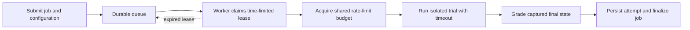

# P4A2 — Design an overnight evaluation service

Use 10–20 minutes to study the example and answer the recall questions. The full activity has a 60-minute timebox, including study.

## Follow one of 1,000 jobs

A job is the logical task, such as running S1 under baseline for repetition 3. An attempt is one execution of that job. A retry after a worker crash gets a new attempt ID while retaining the job ID. Planned repetitions get distinct job IDs so reliability recovery cannot inflate the experiment’s sample size.

A durable queue stores pending work across restarts. A lease gives a worker a temporary claim; a heartbeat can renew it during legitimate work. If the worker disappears, another can claim the job after expiry. With bounded concurrency only a fixed number of trials run simultaneously. A shared rate limiter also controls requests or tokens across workers. Ten individually compliant workers can collectively exceed an account limit.

## Walk through a crash

Worker A saves an artifact just before losing its lease. Worker B retries. Store artifacts under distinct attempt IDs and use a conditional database update to finalize the logical job only for its active lease. A late A can retain diagnostic evidence without overwriting B’s result. Acknowledge queue delivery after durable finalization; repeated delivery should find the completed job. Explain what happens on both sides of that acknowledgement.

Set per-call and per-attempt timeouts. Retry transient infrastructure failures with a limit, backoff and jitter. A valid grader verdict that the task failed is a completed measurement. Re-running until it passes biases the study. Preserve incomplete executions, grader errors and task failures separately.

## Check overnight feasibility

If a job averages six minutes, 1,000 jobs need about 100 worker-hours. In an eight-hour window that is at least 13 concurrent workers before retries, queue delays and rate limits. Label these as illustrative assumptions and recalculate with observed throughput. Sketch the design from memory and identify where a duplicate delivery, a worker crash and a rate-limit response each go.
