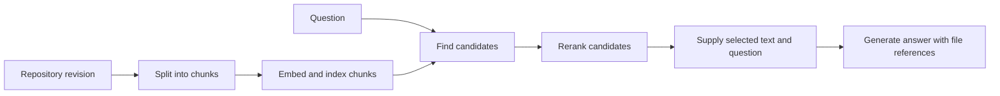

# Retrieval and fine-tuning

Use 10–20 minutes to study the material below. Questions and answers are at the end, behind a spoiler warning.

## Answer a question about yesterday’s code change

Suppose a developer asks, “Which setting limits parallel branch checks?” The answer lives in a private repository whose contents change daily. Retrieval-augmented generation (RAG) finds relevant material at request time and supplies it as context for a generated answer.

A **chunk** is a retrievable portion of a document, perhaps a function plus its docstring. Small chunks can omit the definition needed to interpret a line. Very large chunks can crowd out other evidence. Attach file path, revision and permissions to each chunk.

An **embedding** is a learned list of numbers representing features of an input. A retrieval system compares the question’s vector with indexed vectors to find candidates. Similarity can bring back related concepts even when words differ. Exact text search can also help with identifiers. A **reranker** looks more closely at the question and candidate passages together to reorder a short list. Generation then uses the selected text as part of its input.

## Decide what to change

Fine-tuning continues training on examples and updates learned parameters, which can include a small set of adapter weights. It can teach a recurring response format or behavior. Daily source changes can instead be reflected by refreshing affected index entries. Check read permissions at retrieval time and carry the revision into the answer.

## Diagnose before tuning

If yesterday’s identifier appears in the answer, inspect the index revision, candidate list, final context and generated text in order. A missing new file suggests an indexing issue. A correct passage retrieved but dropped suggests a ranking or context issue. An accurate passage included but contradicted points to generation.

---

## ⚠️ SPOILERS: questions and answers

Prepare using only the text above this line. Everything below it asks the questions and then answers them.

### Questions

1. Draw the retrieval pipeline from memory, from repository revision to answer.
2. Which of these needs the model's weights retrained: (a) a file added yesterday must be answerable; (b) answers must always follow one team-specific format; (c) users mustn't see files they can't read?
3. Why is retrieval a plausible starting point for a private codebase that changes daily?
4. When does exact text search beat embedding similarity, and when the other way round?
5. An answer misses yesterday's identifier. Where's the problem if the right passage was among the candidates but not in the final context? And if it was in the final context, but the answer contradicts it?

**Stop here.** Answer every question aloud before you read on.

### Answers

1. Repository revision → chunks, each with path, revision and permissions → embed and index. Question → find candidates → rerank → supply the selected text with the question → generate an answer with file references.
2. (a) No: refresh the index entries for the changed files. (b) Possibly: a recurring format or behavior is what fine-tuning can teach, though instructions in the prompt are the cheaper first try. (c) No: check read permissions at retrieval time. Weights can't enforce access.
3. Retrieval reads the current revision at request time, so a daily change needs only the affected index entries refreshed. Fine-tuning would need retraining to absorb each change, and weights can't cite a file or revision, or check who may read it.
4. Exact search wins for identifiers, error strings and config keys, where the words must match. Embeddings win when the question paraphrases the code, with different words for the same concept.
5. Ranking or context selection: the passage was found, then dropped. Generation: the model had the evidence and didn't use it.
