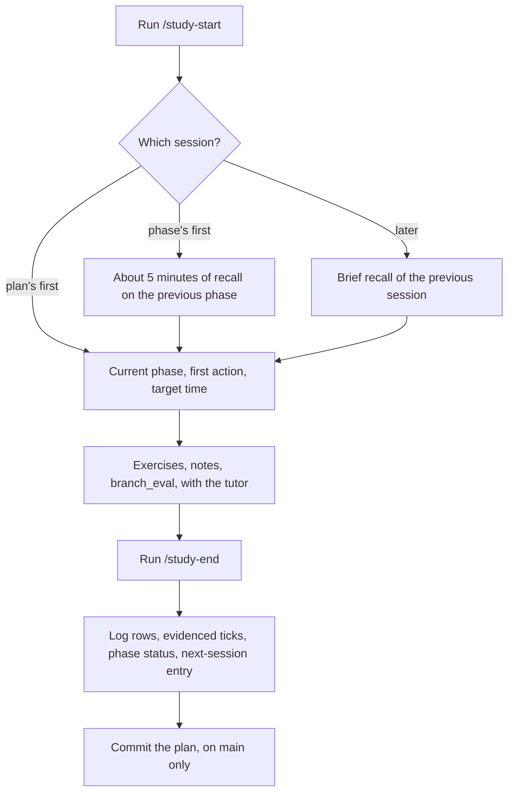

# Architecture — study-ai-agents

Root design file. It covers *how* the work is put together; *why* is in [product.md](product.md), and why a significant choice was made is in [decisions/](decisions/). Keep it describing what's built (or decided). Diagrams are Mermaid, so they stay text, diffable, and mergeable.

## Structure

| Path | Holds |
| ---- | ----- |
| `study_plan.md` | The plan: its phases and checklists, the progress log and the next-session entry |
| `practice/<slug>/` | One coding exercise: `<slug>.py`, `test_<slug>.py`, the frozen first attempt `<slug>_attempt.py`, and a `README.md`. [practice/README.md](../practice/README.md) gives the steps and the slug's form |
| `notes/p<phase>_<topic>.md` | Notes on a study topic, and explanations or stories the human gave, each with Claude's review of it |
| `src/branch_eval/` | The Python package: Phase 1's results reader, then the evaluation's grader and runner |
| `tests/` | Tests of `branch_eval` |
| `eval/` | The evaluation's artifacts, from Phase 2 on: scenarios, trial records (`eval/results/*.jsonl`) and saved traces. They're evidence, so they're committed |
| `.claude/rules/tutoring.md` | How Claude tutors, in every session |
| `.claude/skills/study-start/`, `.claude/skills/study-end/` | The routines that open and close a session |

It's a uv project on Python 3.12, with pytest and ruff. `make check` lints everything but frozen attempts (`*_attempt.py`), then runs every test under `practice/` and `tests/`. It passes when there are no tests yet.

Study work (exercises, notes, the plan) is committed directly on `main`. Only the evaluation harness, from Phase 2 on, is delivered as changes on their own branches.

### Evaluation trials

A trial's workspace lives outside this repository. Claude Code loads `CLAUDE.md` files from a working directory's parents, so a workspace inside it would put this repository's `CLAUDE.md` and `AGENTS.md` into every trial.

_TBD: how far can user-level configuration and state, such as `~/.claude/CLAUDE.md`, user skills and auto memory, be kept out of trials on a subscription login, where `--bare` is unavailable?_

## Data model

### Trial record

One trial's result, as one JSON object per line of a `.jsonl` file.

| Field | Type | Meaning |
| ----- | ---- | ------- |
| `trial` | string | The trial's own ID, unique across all records |
| `scenario` | string | The scenario it ran, such as `S1` |
| `config` | string | The configuration it ran under, such as `baseline` |
| `attempt` | integer, from 1 | Which repeat of this scenario under this configuration |
| `outcome` | `"pass"`, `"fail"` or `"error"` | `fail`: the task wasn't done. `error`: the trial couldn't run or be graded |
| `error` | string or null | The error message, if there is one |
| `elapsed_s` | number | Seconds the trial took |

Every field but `error` is required. Readers ignore fields they don't know, so the runner can add its own.

```json
{"trial": "t-0001", "scenario": "S1", "config": "baseline", "attempt": 1, "outcome": "pass", "error": null, "elapsed_s": 41.7}
```

### Progress log

A row in `study_plan.md`'s progress log covers one phase's work in one session:

| Column | Holds |
| ------ | ----- |
| Date | `YYYY-MM-DD` |
| Phase/activity | `Phase N — ` and the titles of the activities worked on, as the plan names them, such as `Phase 1 — Python through a useful program` |
| Minutes | A whole number, as the human reports it |
| Evidence or artifact | The files the work produced, the evidence for any checkbox ticked, and `Claude wrote:` with what and where, when Claude wrote or fixed code |
| Mistakes and unresolved questions | As the human reports them |
| Next priority | What comes next, including unfinished work when a phase stops over budget |

A phase's status in the phase overview is `Not started`, then `In progress` once it has a log row, then `Done` once the human confirms it's finished, with its unfinished work recorded.

## Key flows

### Study session



An exercise's own steps, from blank file to frozen attempt to correction, are in [practice/README.md](../practice/README.md).
